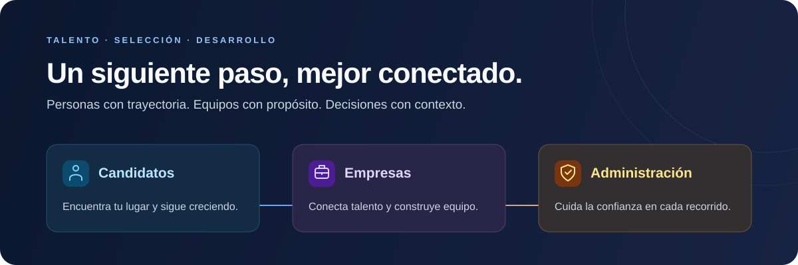
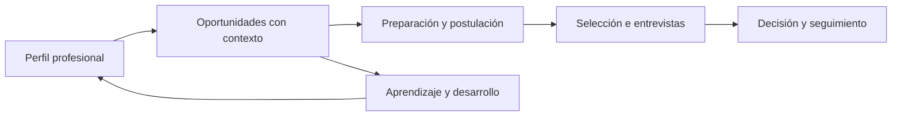

<p align="center">
  
</p>

<h1 align="center">TalentSync AI</h1>
<p align="center"><strong>Talento que conecta. Oportunidades que impulsan.</strong></p>
<p align="center">Empleo, selección y desarrollo profesional en un mismo recorrido.</p>

<p align="center">
  <a href="https://talentsync-ai.pages.dev">Conocer TalentSync</a> ·
  <a href="#tres-roles-un-mismo-propósito">Explorar los roles</a> ·
  <a href="#compatibilidad-con-explicaciones">Cómo funciona</a> ·
  <a href="#tecnología-y-arquitectura">Tecnología</a>
</p>

<p align="center">
  <a href="https://github.com/Aokijij/TalentSync-AI/actions/workflows/ci.yml"></a>
  
  
  
</p>

<p align="center"></p>

## El siguiente paso necesita contexto

Buscar empleo implica más que enviar una hoja de vida. Contratar requiere más que acumular candidaturas. **TalentSync AI conecta ambos recorridos**: reúne la trayectoria profesional, explica la afinidad con las vacantes y permite seguir cada proceso con información compartida y permisos definidos.

El candidato puede entender sus oportunidades y prepararse para ellas. La empresa puede revisar talento, coordinar a su equipo y comunicar avances. La administración dispone de herramientas para gestionar la plataforma y supervisar su operación.

## Tres roles, un mismo propósito

| | Candidatos | Empresas | Administración |
| :--- | :--- | :--- | :--- |
| **Propósito** | Encontrar oportunidades y avanzar profesionalmente. | Construir equipos con un proceso organizado. | Mantener una plataforma confiable y ordenada. |
| **Espacio propio** | Perfil, hoja de vida, vacantes, aprendizaje y postulaciones. | Organización, ofertas, talento, equipo y selección. | Usuarios, organizaciones, catálogos y operación. |
| **Identidad** | Azul: claridad y proyección. | Violeta: colaboración y construcción de equipos. | Ámbar: supervisión y criterio. |

### Para quienes buscan su siguiente oportunidad

- **Un perfil con trayectoria.** Experiencia, formación, habilidades, idiomas, certificaciones y evidencias en un mismo lugar.
- **Hoja de vida con control.** Importación de PDF con revisión de los datos extraídos, versiones guardadas, personalización y exportación.
- **Búsqueda con contexto.** Filtros de ubicación, modalidad, sector, contrato y salario; comparación de ofertas y recomendaciones explicadas.
- **Postulaciones con seguimiento.** Preparación de la candidatura, respuestas de preselección, etapas, compromisos de respuesta e historial.
- **Preparación y aprendizaje.** Orientación profesional, cursos, planes y retos relacionados con habilidades que se quieren reforzar.
- **Entrevistas organizadas.** Agenda, indicaciones y conexión opcional con Google Calendar.

### Para quienes construyen equipos

- **Identidad empresarial.** Perfil público con propósito, cultura, beneficios e imagen de la organización.
- **Vacantes claras.** Requisitos, condiciones, habilidades, idiomas y preguntas de preselección configurables.
- **Talento relevante.** Búsqueda y comparación de perfiles, explicación de compatibilidad e invitaciones a candidatos.
- **Selección en equipo.** Bandeja de candidaturas, tablero de procesos, etapas, notas internas y permisos de colaboración.
- **Entrevistas y decisiones.** Asignación de participantes, programación, evaluaciones y comunicación de avances.
- **Continuidad del proceso.** Cierre y reapertura de vacantes con conservación del historial según la opción elegida.

### Para quienes cuidan la plataforma

- **Acceso independiente** y controles según el rol administrativo.
- **Gestión de usuarios, empresas y vacantes**, junto con revisión de organizaciones e incidencias.
- **Catálogos de empleo y formación**, con importación, revisión y atribución de las fuentes externas.
- **Visibilidad operativa** de integraciones, entregas de correo y tareas de mantenimiento.

## De la oportunidad al siguiente paso



Cada rol participa desde su propio espacio. La empresa conserva las decisiones de selección; el candidato puede revisar lo que comparte y seguir sus procesos.

## Compatibilidad con explicaciones

La compatibilidad relaciona **habilidades, contexto profesional y requisitos de la vacante**. Cuando corresponde, incorpora idiomas, formación, experiencia y las condiciones declaradas. Las explicaciones permiten contrastar coincidencias, brechas y requisitos que necesitan revisión.

- Las vistas del candidato y de la empresa comparten las reglas del motor.
- La falta de información se distingue de un requisito cumplido.
- Las ofertas externas incluyen señales sobre la calidad y confianza de sus datos.
- Las respuestas de preselección pueden aportar un ajuste privado para la empresa; las respuestas abiertas requieren revisión humana.

**El porcentaje es una orientación, no una probabilidad de contratación ni una certificación de competencias.** La extracción de un CV se puede corregir y las evidencias de aprendizaje conservan su origen y alcance.

## Conexiones que acompañan el recorrido

| Área | Integraciones contempladas en el código |
| :--- | :--- |
| **Identidad** | Acceso y vinculación con Google, GitHub y LinkedIn; opciones corporativas de Microsoft. |
| **Agenda** | Google Calendar para sincronizar entrevistas autorizadas. |
| **Oportunidades** | JSearch, Get on Board y bolsas de empleo de Greenhouse y Lever; importación de catálogos. |
| **Aprendizaje y evidencias** | Recursos de Microsoft Learn y YouTube, proyectos de GitHub y actividad de Codewars. |
| **Correo** | Plantillas transaccionales compartidas para Gmail autorizado, SMTP y Resend. |

La disponibilidad depende de la configuración, autorización y condiciones de cada proveedor. Las vacantes externas conservan su procedencia y la postulación continúa en el sitio de origen.

## Confianza desde el diseño

- Autorización por rol y separación entre información personal, datos compartidos y notas internas de selección.
- Herramientas de seguridad de cuenta, verificación y autenticación adicional según el acceso.
- Consentimiento de registro y documentos de privacidad y términos accesibles desde la plataforma.
- Exportación de datos y solicitud de eliminación de cuenta.
- Descarga autorizada de archivos y almacenamiento privado de documentos.
- Interfaz adaptable a móvil y escritorio, con temas claro y oscuro y controles de accesibilidad.

[Política de privacidad](https://talentsync-ai.pages.dev/privacidad) · [Términos de uso](https://talentsync-ai.pages.dev/terminos)

## Tecnología y arquitectura

| Capa | Base tecnológica | Responsabilidad |
| :--- | :--- | :--- |
| **Experiencia web** | React 19 · Vite · Tailwind CSS · React Router | Interfaces y recorridos de cada rol. |
| **API** | FastAPI · Pydantic | Contratos HTTP, validación y acceso a las funciones. |
| **Aplicación y dominio** | Python | Casos de uso, compatibilidad y reglas del negocio. |
| **Persistencia** | SQLAlchemy · Alembic · PostgreSQL | Datos y evolución del esquema; SQLite en pruebas aisladas. |
| **Documentos** | pypdf · ReportLab · Docling/OCR opcional | Lectura, revisión y generación de hojas de vida. |
| **Calidad** | pytest · Node Test Runner · ESLint · Playwright · GitHub Actions | Pruebas de reglas, API, interfaz y regresión visual. |

El backend separa dominio, aplicación, infraestructura y API. El frontend organiza componentes, páginas, rutas y servicios alrededor de los recorridos de producto.

```text
backend/     API, reglas de negocio, migraciones y pruebas
frontend/    Aplicación web, identidad visual y pruebas de interfaz
scripts/     Herramientas de desarrollo y operación
infra/       Configuración de infraestructura y guías operativas
docs/        Referencias técnicas de desarrollo, diseño y evaluación
```

<details>
<summary><strong>Referencias para quienes mantienen el proyecto</strong></summary>

- [Desarrollo y comprobaciones](docs/DEVELOPMENT.md)
- [Criterios de interfaz](docs/DESIGN.md)
- [Evaluación del motor y los recorridos](docs/EVALUATION.md)
- [Pruebas de interfaz y regresión visual](frontend/quality/README.md)
- [Operación del backend](infra/production/AWS.md)
- [Integraciones](infra/production/INTEGRATIONS.md)

</details>

---

<p align="center"><strong>TalentSync AI</strong><br />Una conexión con sentido entre lo que puedes aportar y lo que viene después.</p>
